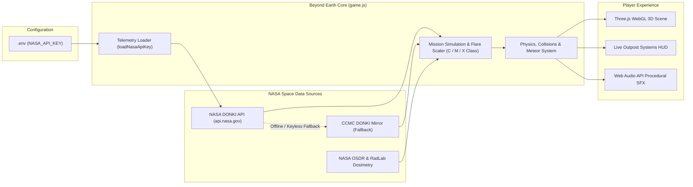
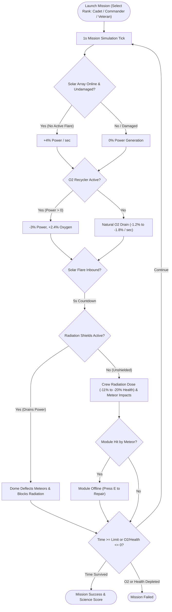

# 🚀 Beyond Earth – Junior Astronaut Mission Trainer

**Team:** Zero-G Cadets  
**Challenge:** Build a Junior Astronaut Mission Trainer (NASA Space Apps Challenge 2026)  
**Live Playable Link:** https://engr-aimanafzal.github.io/Zero-G-Cadets/

---

## 📖 Project Overview

**Beyond Earth** is a 3D browser-based survival and resource-management game designed for students aged 7–12. Players step into the boots of a Junior Astronaut stationed at an Artemis lunar outpost and must balance critical life-support systems (**Power**, **Oxygen**, and **Health**) while surviving real-world space weather hazards.

Every engineering decision has a real trade-off:
- Running the **O₂ Recycler** replenishes breathable air but drains **Power**.
- Activating **Radiation Shields** protects the outpost from solar storms and meteors, but rapidly consumes **Power**.
- Unshielded modules struck by meteors become **DAMAGED** and must be repaired on foot before life support fails.

---

## 🏗️ System Architecture & Game Loop

### 1. NASA Data & Engine Architecture



### 2. Outpost Resource & Survival Loop



---

## ✨ Key Features

- **Real-Time NASA DONKI Telemetry:** Pulls recent Solar Flare (`FLR`) events from the last 30 days and scales in-game solar storm intensity (`C`, `M`, or `X` class) based on actual solar activity.
- **Mission Ranks (Difficulty Modes):**
  - **Cadet:** 60s mission duration, forgiving Oxygen consumption.
  - **Commander:** 90s mission duration, standard resource drain.
  - **Veteran:** 120s mission duration, faster Oxygen drain and frequent solar storms.
- **Module Breakdowns & Field Repairs:** Meteors can disable unshielded outpost modules (`DAMAGED!`). Players must run to damaged modules and press `E` to restore operations.
- **Jetpack Low-G Boost:** Hold `Shift` or `Space` to ignite the astronaut's jetpack for a 1.65× speed burst with exhaust particles at the cost of extra Oxygen.
- **Meteor Ground Target Rings & Shield Dome:** Incoming meteors project shrinking red landing rings on the lunar floor and vaporize harmlessly against an active Radiation Shield Dome.
- **3 Resource Crate Types:** Collect floating **Oxygen Crates** (Green, `+15% O₂`), **Medkits** (Red, `+15% Health`), and **Power Cells** (Gold, `+20% Power`).
- **Procedural Web Audio SFX:** Zero-dependency synthesized retro space audio (warning klaxons, module toggles, repair chimes, shield deflections, and meteor impacts) with a HUD mute toggle (`🔊 SFX`).

---

## 🎮 Controls & How to Play

| Key / Input | Action |
| :--- | :--- |
| `W`, `A`, `S`, `D` or `Arrow Keys` | Walk across the lunar outpost |
| `Shift` or `Space` | Jetpack Boost (1.65× speed, consumes extra Oxygen) |
| `E` | Toggle module `ON` / `OFF`, or **Repair** a `DAMAGED` module |
| `🔊 SFX` Button (Top Bar) | Mute / unmute procedural sound effects |

---

## 🔬 NASA Data Integration (Traceability)

1. **DONKI (Space Weather Database Of Notifications, Knowledge, Information):**
   - Queries NASA's DONKI Solar Flare (`FLR`) endpoint over the past 30 days using `fetch()`.
   - Dynamically adapts radiation damage, storm duration, shield power drain, and meteor count according to the recorded flare class (`C`, `M`, or `X`).
2. **OSDR (Open Science Data Repository) & RadLab:**
   - Crew health depletion and shielding mechanics model real biological radiation dosimetry constraints from the ISS and deep-space radiation studies.
3. **Artemis Lunar Surface Parameters:**
   - Resource budgeting between solar power generation, life-support oxygenation, and storm shelter shielding mirrors NASA Artemis base-camp engineering trade-offs.

---

## 🛠️ Tech Stack

- **HTML5 & CSS3** – Responsive sci-fi HUD, live Outpost Systems status panel, and mission briefing UI.
- **JavaScript (ES6 Modules)** – Frame-rate independent simulation loop, collision detection, and NASA API integration.
- **Three.js (`v0.160.0`)** – WebGL 3D rendering, lighting, shadows, lunar terrain, habitat dome, and particle effects.
- **Web Audio API** – Real-time procedural sound synthesis with zero external audio assets.
- **NASA Open APIs** – Live DONKI space weather telemetry.

---

## 🚀 Local Setup & Running the Game

### 1. Clone the Repository
```bash
git clone https://github.com/SairajMN/Zero-G-Cadets.git
cd Zero-G-Cadets
```

### 2. Configure Your NASA API Key (`.env`)
Copy `.env.example` or run the command below to safely store your NASA API key in `.env` (get a free key at https://api.nasa.gov/):

```bash
printf "Enter NASA_API_KEY (typing hidden): " && read -s val && echo && echo "NASA_API_KEY=$val" >> ".env" && echo "Saved."
```
*(Note: If `.env` is omitted, such as on GitHub Pages, the game automatically falls back to NASA's CCMC DONKI server.)*

### 3. Start a Local Web Server
Because the game uses ES Modules (`<script type="module">`), serve the directory over HTTP:

**Using Python (built into macOS/Linux):**
```bash
python3 -m http.server 8000
```
Then open **http://localhost:8000** in your browser.

**Or using Node.js:**
```bash
npx serve .
```

---

## 📂 Project Structure

```text
Zero-G-Cadets/
├── index.html      # Main HTML entry point, HUD layout, and Mission Briefing modal
├── style.css       # Styling for HUD bars, Outpost Systems panel, alerts, and animations
├── game.js         # Three.js 3D scene, NASA DONKI API loader, physics, and Web Audio SFX
├── .env.example    # Template for NASA_API_KEY configuration
├── .gitignore      # Excludes .env and local environment files from Git
└── README.md       # Project documentation and architecture diagrams
```
